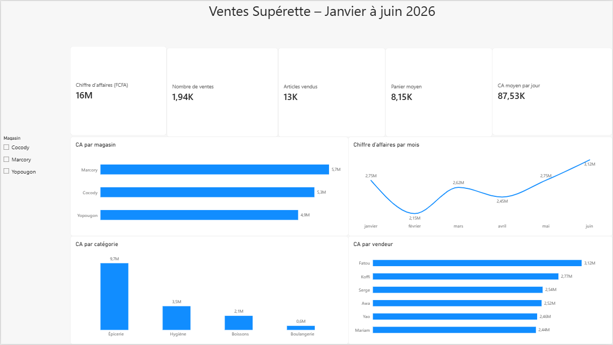
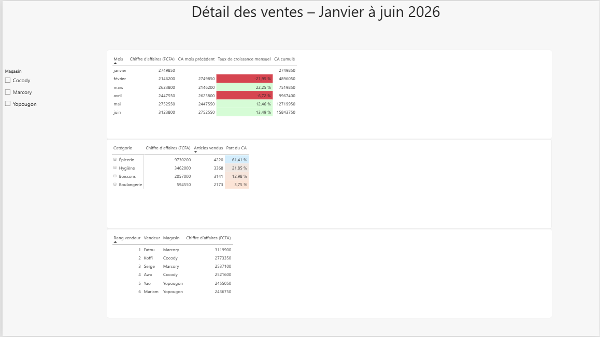

# Tableau de bord des ventes d'une supérette – Power BI

## Le problème

Le gérant d'une supérette avec 3 magasins à Abidjan (Cocody, Marcory, Yopougon) suit ses ventes dans un fichier Excel. Il veut savoir en un coup d'œil **quels magasins, produits et vendeurs font son chiffre d'affaires**, et **comment les ventes évoluent chaque mois**.

## Les données

- Fichier : `donnees/Ventes_Superette_fictive.xlsx`
- 1 944 ventes, du 1er janvier au 30 juin 2026
- Colonnes : ID_Vente, Date, Magasin, Vendeur, Produit, Catégorie, Quantité, Prix_unitaire, Montant (FCFA)
- **Données entièrement fictives**, générées pour l'exercice

## Ce que j'ai fait

1. **Préparation (Power Query)** : import du fichier Excel, contrôle et correction des types de colonnes.
2. **Modélisation** : création d'une table **Calendrier** en DAX (année, mois, trimestre, jour de la semaine), marquée comme table de dates, triée par numéro de mois et reliée à la table des ventes (relation un à plusieurs).
3. **Mesures DAX**, rangées dans une table de mesures dédiée :
   - CA, articles vendus, nombre de ventes (`SUM`, `COUNTROWS`) ;
   - panier moyen et CA moyen par jour (`DIVIDE`, `DISTINCTCOUNT`) ;
   - CA du mois précédent, taux de croissance mensuel et CA cumulé (`CALCULATE`, `DATEADD`, `TOTALYTD`) ;
   - part du CA et rang des vendeurs (`ALLSELECTED`, `ALL`, `RANKX`).
4. **Visualisation** : 2 pages reliées par un filtre Magasin synchronisé
   - *Vue d'ensemble* : 5 indicateurs clés, évolution mensuelle, CA par magasin, par catégorie et par vendeur ;
   - *Détail* : tableau mensuel avec mise en forme conditionnelle (hausse en vert, baisse en rouge), matrice catégorie → produit, classement des vendeurs.

Le fichier Power BI est dans [`powerbi/Projet1_Superette.pbix`](powerbi/Projet1_Superette.pbix) (à ouvrir avec Power BI Desktop, gratuit).

## Résultats clés

- **15,8 millions FCFA** de chiffre d'affaires sur 6 mois, pour 1 944 ventes et un **panier moyen de 8 150 FCFA**.
- **Marcory** est le premier magasin (**35,7 %** du CA), devant Cocody (33,4 %) et Yopougon (30,9 %).
- L'**épicerie** pèse **61 %** du chiffre d'affaires. Le **riz parfumé 5 kg** à lui seul représente **27 %** du CA total.
- **Février** est le mois le plus faible (-22 % par rapport à janvier). Ce n'est pas seulement parce qu'il est plus court : même ramené au jour, il reste le plus bas (**76 650 FCFA/jour**, contre 88 705 en janvier).
- **Juin** est le meilleur mois (**3,12 M FCFA**, +13,5 % par rapport à mai), avec deux mois de hausse consécutifs.
- Le pain se vend en grande quantité (1 147 unités) mais ne pèse que 1,8 % du CA : c'est un **produit d'appel**, pas un produit de marge.

## Recommandations

- **Sécuriser l'approvisionnement en riz** : une rupture de stock sur ce seul produit menacerait plus d'un quart du chiffre d'affaires.
- **Analyser Yopougon** : plus de ventes que Cocody (646 contre 632) mais un CA plus faible, car son panier moyen est le plus bas (7 572 FCFA contre 8 378 à Cocody et 8 494 à Marcory). Une promotion sur les produits d'épicerie à forte valeur pourrait le faire monter.
- **Préparer février** : prévoir des promotions en début de mois pour amortir la baisse habituelle.

## Outils

Power BI Desktop · Power Query · DAX · Excel

## Contact

Jonathan Seka Kouame · [linkedin.com/in/jonathan-seka-kouame](https://linkedin.com/in/jonathan-seka-kouame)
